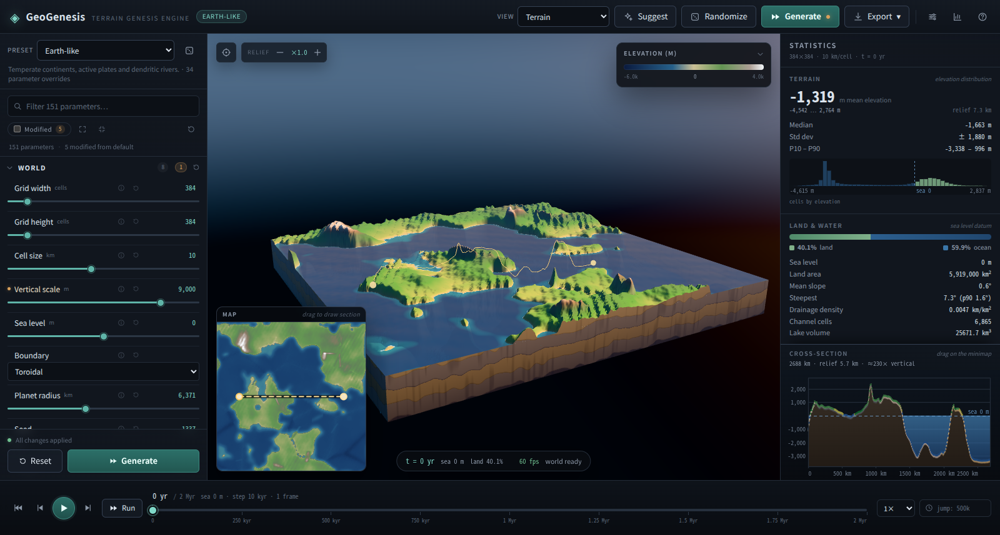
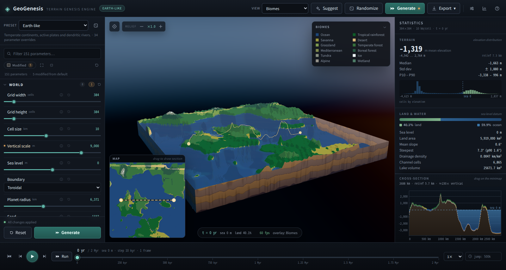
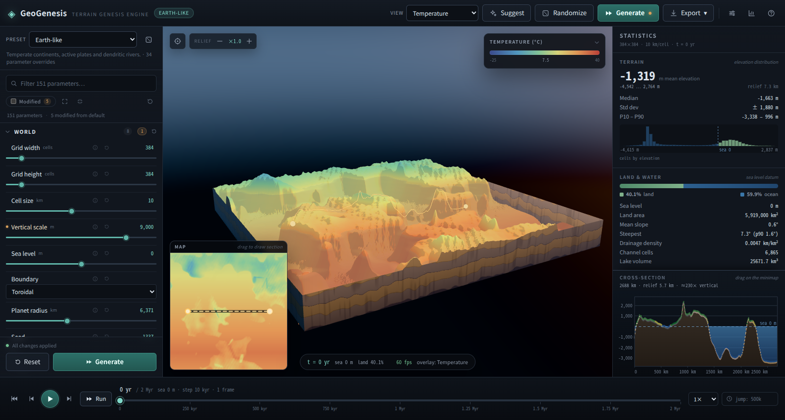
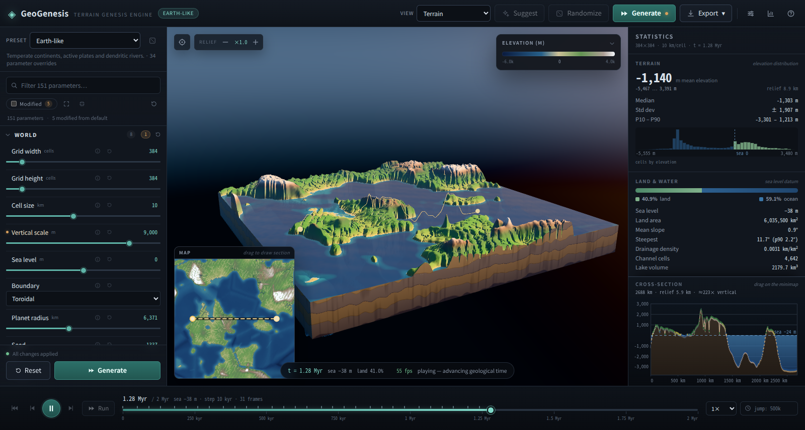
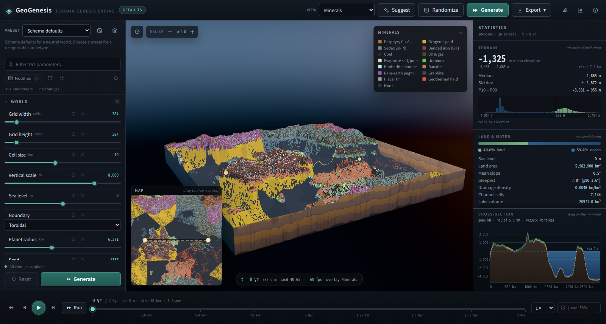
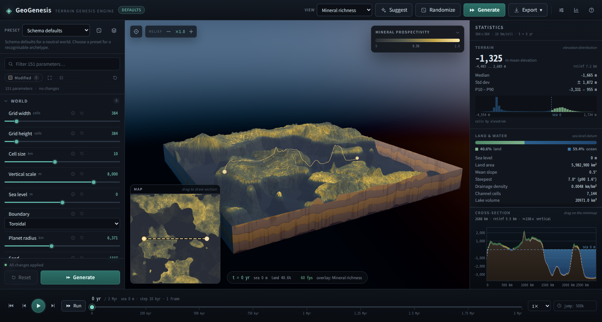
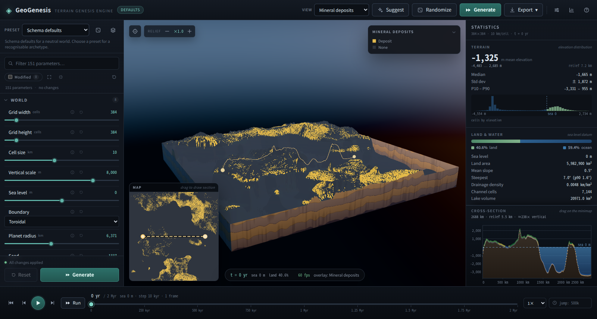
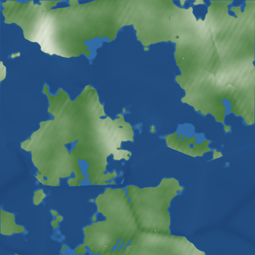
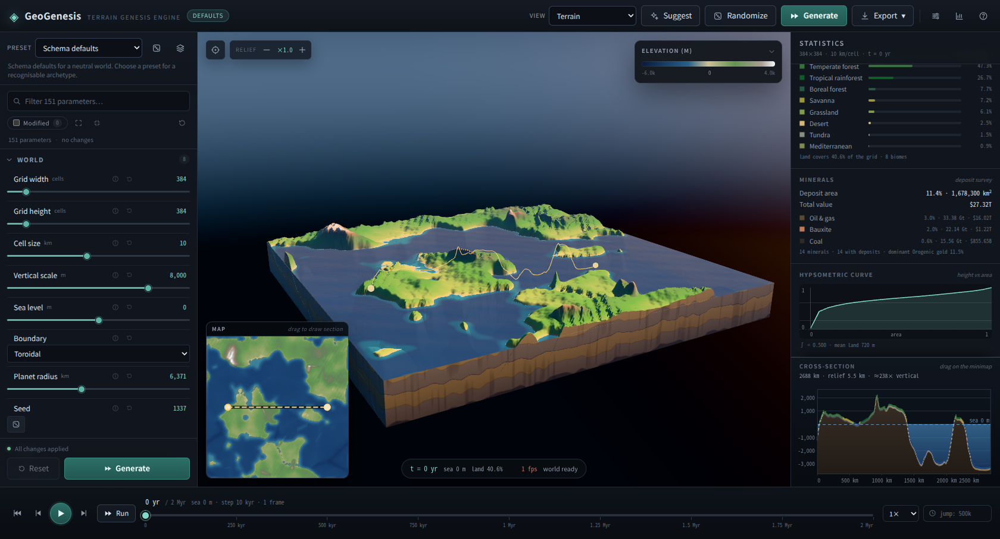
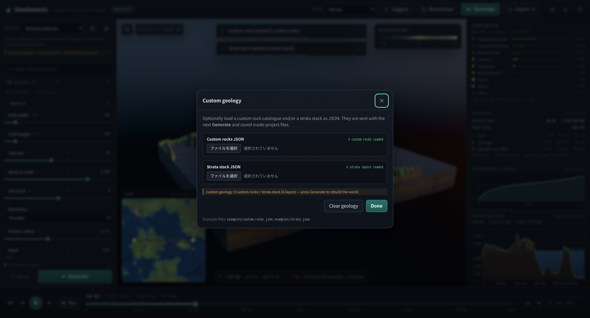

# GeoGenesis

[](https://github.com/nico2525nn/geogenesis/actions/workflows/ci.yml)
[](LICENSE)


**A scientific terrain-genesis and landscape-evolution engine.**

**[Live demo](https://nico2525nn.github.io/geogenesis/)** · [Documentation](docs/ARCHITECTURE.md) · [SPEC](SPEC.md)

GeoGenesis turns a seed and a parameter set into a planet-like terrain, then
evolves it over geological time with coupled tectonics, hydrology, erosion,
sediment transport, climate and geology. The engine is deterministic Rust; the
UI is a browser application that runs the engine as WebAssembly in a Worker.

```
seed + parameters ─► plate kinematics ─► crust & isostasy ─► relief
                  ─► climate ─► hydrology ─► erosion & deposition
                  ─► geology ─► statistics / history / maps / exports
```



## Highlights

- **Kinematic plate tectonics** — moving plates, convergent/divergent/transform
  boundaries, orogens, trenches, ridges, hotspots with trails, Airy isostasy and
  flexural smoothing, erosional unloading and sediment loading.
- **Continents that look like continents** — a rank-normalised craton field
  biased by plate type, smoothed crustal thickness (shelves and slopes come for
  free), and water-loaded Airy equilibrium for ocean basins.
- **Emergent climate** — latitude/regional temperature with lapse rate,
  continentality, ocean moderation, CO₂ and orbital cycles; upwind moisture
  transport with orographic rain-out and rain shadows; extended Whittaker
  biomes and logistic vegetation succession.
- **Mineral and resource deposits** — 14 deposit types scored from tectonics,
  lithology, climate and hydrology, with a deterministic prospectivity map,
  economic threshold mask and tonnage/value inventory (CLI `minerals.png` /
  `minerals.json`, Web UI overlay + panel).
- **Large grids** — streaming tiled generation produces 4096² worlds in
  **3.4–3.8 s** with **123–209 MB** peak RSS (SPEC targets <30 s / <1 GB).
- **Spherical worlds** — exact per-cell latitude-band areas flow through
  hydrology, climate means, statistics and the mass ledger.
- **User-defined geology** — custom rock definitions (colour, Mohs hardness,
  permeability, friction, cohesion, density, solubility, weathering rate,
  origin) and a 1–100 layer stratigraphy stack (thickness, dip, strike, fault
  offset, unconformity) loaded from JSON; see [examples/](examples) and the
  `--rocks` / `--strata` CLI flags.
- **Interactive Web UI** — schema-driven 151-parameter panel, three.js
  viewport with 20 overlays (including minerals), minimap and cross-section,
  2 Myr timeline with exact seek/playback, project save/load (with custom
  geology), FPS HUD, deterministic world `Suggest`, and 12 export formats.
- **Extensible processes** — user-defined Rust process plugins with a
  `ProcessPlugin` trait, exact mass accounting, deterministic replay and a
  built-in meteor-impact demonstration; out-of-tree example crate included
  ([docs/PLUGINS.md](docs/PLUGINS.md)).
- **Exports** — terrain/biome/river PNG, 16-bit heightmap PNG, normal-map PNG,
  cross-section PNG, raw `f32`, OBJ mesh, self-contained glTF 2.0, XYZ point
  cloud, OpenEXR heightmap, NetCDF-3 gridded fields, mineral map/inventory and
  stats/params JSON; the Web UI adds viewport PNG and all binary formats.
- **Real erosion physics** — implicit stream-power incision (stable at
  geological time steps), hillslope diffusion, soil production, mass-conserving
  landslides, glacial ice flow and U-valley carving, aeolian saltation/dunes,
  wave fetch and coastal retreat, chemical dissolution kinetics.
- **Mass ledger** — every process reports erosion, deposition and export; the
  driver accumulates a ledger and verifies conservation.
- **Deep time you can scrub** — timeline frames, exact deterministic seeking,
  chunked replay in a Worker, no blocking of the UI.
- **Instant parameter preview** — while sliders move, the browser renders a
  coarse version of the same world from the real generation pipeline, so
  parameter changes are visible immediately without a full rebuild.
- **One schema, three consumers** — the Rust parameter schema drives the CLI,
  the WASM ABI and the whole parameter UI. Adding a parameter in Rust makes it
  appear in the browser automatically.
- **Tiny, dependency-free WASM** — no wasm-bindgen, no external crates; the
  module is a few hundred kB and ~140 kB gzipped.

## Quick start

Requirements: Rust (stable, with the `wasm32-unknown-unknown` target), Node 20+
and `make` (or run the commands manually).

```bash
# 1. Build the engine to WebAssembly and copy it into web/public
rustup target add wasm32-unknown-unknown
./scripts/build-wasm.sh

# 2. Install web dependencies (three.js, Vite, TypeScript)
cd web && npm install && cd ..

# 3. Development server
make dev          # http://localhost:4000

# Production build
make web          # web/dist

# Rust tests + JS/WebAssembly ABI smoke test
make test

# Command-line generation (PNG maps, OBJ mesh, XYZ cloud, raw heights, stats)
make cli
./target/release/geogenesis generate --preset earthlike --seed 42 --grid 384
./target/release/geogenesis generate --preset volcanic --grid 256 --steps 100
./target/release/geogenesis bench --grid 256 --steps 20
./target/release/geogenesis sweep --seeds 8 --grid 128

# Tiled 4096² generation (streamed, <1 GB) and custom geology
./target/release/geogenesis generate --tiled --grid 4096
./target/release/geogenesis generate --rocks examples/custom-rocks.json --strata examples/strata.json
./target/release/geogenesis generate --plugin impacts --run

# Large-grid tiled generation (plan, memory budget, streamed exports)
./target/release/geogenesis tiles --grid 4096 --tile-size 512 --halo 32 --workers 8 --run --out out/tiled4096
./target/release/geogenesis generate --tiled --grid 4096 --out out/tiled-world
```

`--set key=value` overrides any schema parameter, e.g.
`--set kf=2e-4 --set precipitation_mm=2400`. `--run` advances the full
configured duration; `--out dir` chooses the export directory.

## Presets

| key | world |
| --- | --- |
| `earthlike` | temperate continents, active plates, dendritic rivers |
| `young_orogeny` | fast plates, high uplift, rugged young mountains |
| `archipelago` | many small plates, plume volcanism, warm rainy ocean |
| `arid_plateau` | hot dry highlands shaped by wind and flash floods |
| `icehouse` | cold planet with ice caps and strong glacial carving |
| `ancient_peneplain` | hundreds of millions of years of erosion |
| `supercontinent` | few slow plates, vast interior, low broad landmass |
| `volcanic` | dense plume volcanism and young cones |
| `riverworld` | very wet, low relief, strongly dendritic drainage |

Presets are plain parameter overrides in `crates/core/src/params/presets.rs`,
and the same table is served to the UI.

## Screenshots

| | |
| --- | --- |
|  |  |
| Terrain shading, water, cliff skirt, minimap and statistics | Biome overlay with categorical legend |
|  |  |
| Temperature overlay | After 1.3 Myr of evolution (sea level, draining rivers, ice) |
|  |  |
| Dominant-mineral map (14 deposit types, catalogue legend) | Prospectivity / richness overlay |
|  |  |
| Economic deposit mask | 4096² tiled generation preview (4096² in 3.4–3.8 s) |
|  |  |
| Statistics: mineral inventory (area, value, top deposits) | Custom rocks + strata stack loaded from JSON |

## Architecture

```
crates/core/      engine: grid/fields, params/schema, noise, plates, uplift,
                  geology, rocks, minerals, climate, hydrology, erosion/*,
                  pipeline, tiling, sim/history, plugin, stats, export
crates/plugin-example/  out-of-tree example process plugin
crates/wasm/      raw C-ABI bridge (no dependencies)
crates/cli/       geogenesis CLI: generate / bench / sweep / schema / presets
web/              Vite + TypeScript + three.js UI (Worker owns the WASM engine)
scripts/          build-wasm.sh, smoke-wasm.mjs, ui-shot.mjs (CDP screenshots)
docs/             ARCHITECTURE.md, PHYSICS.md
SPEC.md           original specification (Japanese)
```

Detailed design: [docs/ARCHITECTURE.md](docs/ARCHITECTURE.md).
Step-by-step introduction: [docs/TUTORIAL.md](docs/TUTORIAL.md).
Current status against the specification: [docs/STATUS.md](docs/STATUS.md).
Remaining work and acceptance criteria: [docs/ROADMAP.md](docs/ROADMAP.md).
Plugin API: [docs/PLUGINS.md](docs/PLUGINS.md). Validation: [docs/VALIDATION.md](docs/VALIDATION.md).
Physics, equations, references and known approximations:
[docs/PHYSICS.md](docs/PHYSICS.md).

## Performance

Measured on the development machine (x86_64, release + LTO). Full method and
more numbers: [docs/BENCHMARKS.md](docs/BENCHMARKS.md).

| metric | SPEC target | measured |
| --- | --- | --- |
| 512² initial generation | < 500 ms | 420 ms |
| 1024² initial generation | < 3 s | 1.82 s |
| 4096² tiled generation | < 30 s | **3.4–3.8 s** (123–209 MB peak RSS) |
| memory at 4096² | < 1 GB | **~125–210 MB** measured |
| WASM size | < 2 MB gzip | 216 KB gzip (602 KB raw) |
| WebGL 100k triangles | 60 fps | **59.9 fps** at 384² (294k tris) on hardware GL; 59.8 fps during playback |
| 4096² generation (streaming tiled) | < 30 s / < 1 GB | **3.4–3.8 s / 123–209 MB** |
| 384² frame update | < 16 ms | 7.2 ms GPU-side upload (hardware GL), ~12 ms software GL |
| slider change → preview (96²) | < 16 ms | **14 ms** generation + ~100 ms UX debounce |
| 384² full 2 Myr run (native) | — | 5.5 s (27.7 ms/step) |

Run `make bench` to reproduce.

## Status

The full SPEC §13 quality targets are met and verified: generation speed and
memory (including 4096² tiled), WASM size, parameter-preview latency and
hardware-GPU 60 fps; the independent validation harness (321 core + 14
integration + 3 plugin + 5 WASM ABI tests) checks determinism, mass
conservation, climate/hydrology invariants, analytic erosion laws and export
formats. Remaining non-goals and follow-ups are tracked in
[ROADMAP.md](docs/ROADMAP.md).

## License

MIT.
